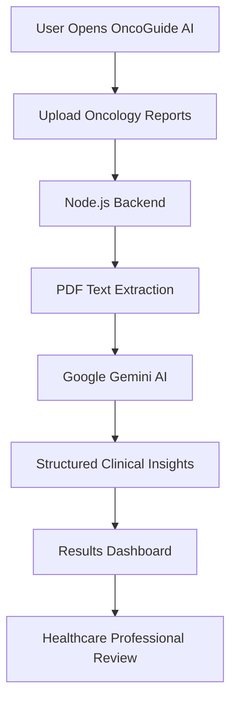
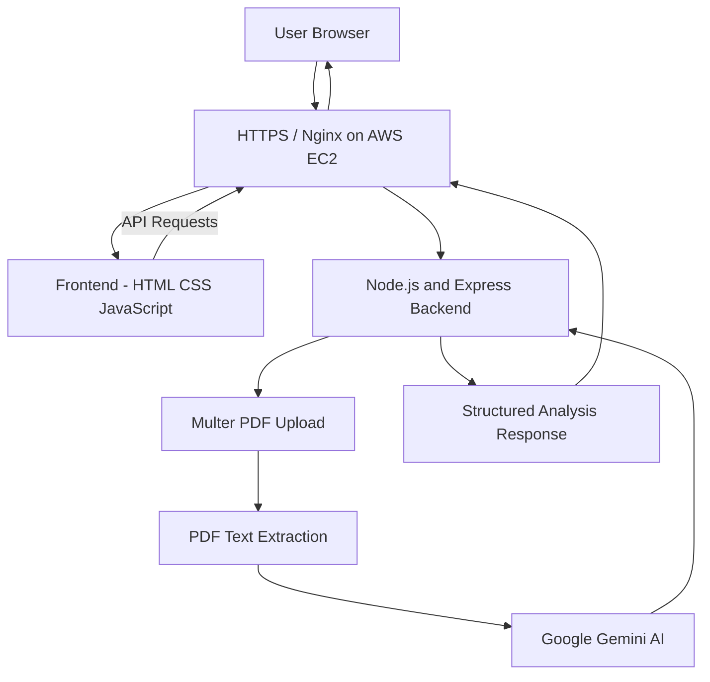

# 🩺 OncoGuide AI
### AI-Powered Oncology Report Analysis Platform

**Transforming Scattered Medical Reports into Meaningful Clinical Insights**

**Team HeartByte | Indira Gandhi Delhi Technical University for Women (IGDTUW)**

[](https://oncoguide-ai.duckdns.org/)
[](https://aws.amazon.com/ec2/)


---

## 🌐 Live Project

**Live Website:** https://oncoguide-ai.duckdns.org/

**GitHub Repository:** https://github.com/Geetanshi-Arora/ONCOGUIDE_AI

OncoGuide AI is deployed on Amazon Web Services (AWS) using Amazon EC2, Nginx, Node.js, and HTTPS encryption.

---

## 📌 Project Overview

**OncoGuide AI** is an AI-powered web application designed to assist healthcare professionals in analyzing and understanding oncology-related medical reports.

Cancer assessment involves multiple investigations, including biopsy reports, immunohistochemistry (IHC), CT scans, and blood investigations. These documents often contain important clinical findings scattered across different reports.

Manually reviewing and connecting this information can be time-consuming.

OncoGuide AI addresses this challenge by providing a centralized platform where multiple oncology reports can be uploaded and analyzed together using **Google Gemini AI**.

The application generates structured clinical insights, helping doctors review relevant findings more efficiently.

> **Disclaimer:** OncoGuide AI is a hackathon prototype intended for clinical information support. It does not provide a confirmed medical diagnosis and cannot replace professional medical judgment.

---

## 🎯 Problem Statement

Cancer-related medical information is often distributed across multiple documents from different laboratories and diagnostic departments.

Healthcare professionals must manually review these reports to understand:

- Cancer type and pathology findings
- Reported cancer staging information
- Biomarker status and IHC results
- Imaging observations
- Relevant blood investigation findings

This fragmented workflow can increase review time and make information consolidation difficult.

### 💡 Our Solution

OncoGuide AI allows users to upload multiple oncology-related reports through a single interface.

The system extracts PDF text, processes the information using Google Gemini AI, and presents consolidated findings in a structured, accessible format.

The objective is to reduce the effort required to organize medical information and support more efficient clinical review.

---

## ✨ Key Features

### 1. Multi-Report Upload
- Upload multiple medical reports in PDF format.
- Supports oncology-related biopsy, IHC, imaging, and blood investigation reports.
- Brings information from separate documents into one analysis workflow.

### 2. AI-Powered Medical Report Analysis
- Uses Google Gemini AI to analyze extracted report text.
- Identifies relevant oncology-related findings.
- Organizes important information into structured insights.

### 3. Consolidated Clinical Insights
- Summarizes findings across uploaded reports.
- Highlights reported cancer types, staging details, biomarkers, and investigation findings when available.
- Helps healthcare professionals review information from multiple sources.

### 4. Structured Results Dashboard
- Displays AI-generated analysis results.
- Presents extracted information in an organized format.
- Improves readability compared with manually reviewing multiple PDF documents.

### 5. Responsive Web Interface
- Simple and accessible user interface.
- Dedicated report upload and results pages.
- Designed for convenient navigation on different screen sizes.

### 6. AWS Cloud Deployment
- Application hosted on Amazon EC2.
- Node.js backend managed using PM2.
- Nginx configured as the web server and reverse proxy.
- HTTPS enabled using Let's Encrypt.

---

## 🔄 How OncoGuide AI Works

**Step 1 — Open the Application**

The user opens OncoGuide AI through the website.

**Step 2 — Upload Medical Reports**

The user uploads oncology-related reports in PDF format.

**Step 3 — PDF Text Extraction**

The backend processes the uploaded PDF documents and extracts their text content.

**Step 4 — AI Analysis**

The extracted text is sent to Google Gemini AI for structured analysis.

**Step 5 — Clinical Insight Generation**

The AI organizes available findings, including reported cancer characteristics, biomarkers, and relevant investigation results.

**Step 6 — Results Visualization**

The generated information is displayed on the results page for review.

### Workflow Diagram



---

## 🛠️ Technology Stack

| Component | Technology | Purpose |
|-----------|------------|---------|
| Frontend | HTML5 | Webpage structure |
| Styling | CSS3 | Interface design and responsiveness |
| Client-side Logic | JavaScript | User interactions and API requests |
| Backend | Node.js | Server-side processing |
| Backend Framework | Express.js | API endpoints and request handling |
| File Upload | Multer | Handling uploaded PDF files |
| PDF Processing | PDF text extraction library | Extracting text from medical reports |
| Artificial Intelligence | Google Gemini AI | Report analysis and insight generation |
| Cloud Hosting | AWS EC2 | Application deployment |
| Web Server | Nginx | Static file serving and reverse proxy |
| Process Management | PM2 | Managing the Node.js server |
| HTTPS | Let's Encrypt / Certbot | TLS certificate management |
| Domain | DuckDNS | Public website address |

---

## 🏗️ System Architecture

The application follows a frontend-backend architecture with AI integration.



### Architecture Explanation

**Frontend:** Provides the user interface for uploading reports and viewing results.

**Backend:** Handles API requests, uploaded documents, PDF processing, and integration with Gemini AI.

**AI Engine:** Processes extracted report information and returns structured oncology-related insights.

**AWS Infrastructure:** Hosts the application and makes it accessible through a public website.

---

## 💻 Implementation Details

### Frontend Implementation

The frontend is developed using HTML, CSS, and JavaScript.

It provides:
- Application homepage
- Report upload interface
- Analysis results page
- Navigation between application sections

The frontend communicates with backend APIs using JavaScript.

### Backend Implementation

The backend is developed using Node.js and Express.js.

Its responsibilities include:
- Receiving uploaded PDF documents
- Processing incoming requests
- Extracting text from PDFs
- Communicating with Google Gemini AI
- Returning structured results to the frontend

### AI Integration

Google Gemini AI is used to process medical report text and generate organized findings.

The system is designed to work with information provided in uploaded documents.

AI-generated results require verification by qualified healthcare professionals.

---

## 📂 Project Structure

The repository is organized into frontend files and a Node.js backend.

```text
ONCOGUIDE_AI/
│
├── backend/
│   ├── server.js
│   ├── package.json
│   └── ...
│
├── screenshots/
│
├── index.html
├── upload.html
├── result.html
├── main.html
│
├── CSS and JavaScript files
│
└── README.md
```

---

## 🚀 Installation and Local Setup

### Prerequisites

Before running the project, ensure that you have:

- Node.js and npm installed
- Git installed
- A Google Gemini API key
- A code editor such as Visual Studio Code

### Step 1 — Clone the Repository

```bash
git clone https://github.com/Geetanshi-Arora/ONCOGUIDE_AI.git
```

### Step 2 — Navigate to the Project

```bash
cd ONCOGUIDE_AI
```

### Step 3 — Open the Backend Folder

```bash
cd backend
```

### Step 4 — Install Dependencies

```bash
npm install
```

### Step 5 — Configure Environment Variables

Create a `.env` file inside the `backend` directory.

Add the required environment variables:

```env
PORT=3000
GEMINI_API_KEY=your_gemini_api_key
```

Configure any additional environment variables required by your current backend implementation.

**Security Note:**
- Never upload the `.env` file to GitHub.
- Keep API credentials private.
- Do not expose secret keys in frontend code.

### Step 6 — Start the Backend

```bash
npm start
```

The backend should start on the configured port, typically:

```text
http://localhost:3000
```

### Step 7 — Run the Frontend

Open the project's `index.html` using a local development server, such as VS Code Live Server.

Ensure the frontend API requests are configured to communicate with the locally running backend.

---

## ☁️ AWS Deployment Details

OncoGuide AI is deployed using **Amazon EC2**.

### Deployment Configuration

| Component | Configuration |
|-----------|---------------|
| Cloud Provider | Amazon Web Services |
| Compute Service | Amazon EC2 |
| Operating System | Ubuntu Server 24.04 LTS |
| Instance Type | t3.micro |
| Backend Runtime | Node.js |
| Process Manager | PM2 |
| Web Server | Nginx |
| Backend Port | 3000 |
| Public Web Ports | 80 and 443 |
| HTTPS Provider | Let's Encrypt |
| Domain Provider | DuckDNS |

### Deployment Process

**1. EC2 Instance Setup**

An Ubuntu-based EC2 instance was launched and configured to host the application.

**2. Server Configuration**

Node.js, npm, Git, and Nginx were installed on the instance.

**3. Repository Deployment**

The application source code was cloned from GitHub onto the EC2 server.

**4. Backend Setup**

Backend dependencies and environment variables were configured.

**5. Process Management**

PM2 was used to keep the Node.js server running.

**6. Nginx Configuration**

Nginx was configured to:
- Serve static frontend files
- Forward `/api/` requests to the backend
- Handle public web traffic

**7. HTTPS Configuration**

DuckDNS was used to provide a public hostname.

A free TLS certificate was configured using Let's Encrypt and Certbot.

**8. Deployment Testing**

The live application was tested for:
- Website accessibility
- PDF upload
- Backend communication
- AI analysis
- Results display
- HTTPS access

### Live Deployment

**https://oncoguide-ai.duckdns.org/**

---

## 📸 Screenshots

Screenshots of the working application can be found in the repository's `screenshots/` directory.

The screenshots demonstrate the application interface, report upload workflow, and AI-generated results.

**Note:** Screenshots should use synthetic or appropriately anonymized medical data.

---

## 🎯 Unique Value Proposition

OncoGuide AI focuses on simplifying the review of oncology-related medical information.

Its key strengths include:

- **Unified Report Analysis:** Multiple medical reports can be analyzed through a single workflow.
- **AI-Assisted Information Extraction:** Gemini AI helps organize complex medical findings.
- **Structured Insights:** Important reported information is presented in an accessible format.
- **Time-Saving Potential:** Reduces the manual effort involved in consolidating report information.
- **Cloud Accessibility:** Deployed on AWS and accessible through a secure HTTPS website.

---

## 📈 Future Scope

Potential future improvements include:

### 1. Medical Image Analysis
Support direct analysis of selected medical imaging formats, subject to clinical validation.

### 2. Patient History and Timeline
Enable longitudinal tracking of reports, findings, and treatment milestones.

### 3. Advanced Clinical Decision Support
Introduce more detailed evidence-linked insights and clinician review workflows.

### 4. Hospital and Laboratory Integration
Support interoperability with hospital information systems and diagnostic laboratories.

### 5. Clinical Validation and Security
Expand testing, implement stronger patient-data safeguards, and evaluate reliability with healthcare professionals.

---

## ⚠️ Limitations and Medical Disclaimer

OncoGuide AI is a prototype created for educational and hackathon purposes.

- AI-generated findings may contain errors or omissions.
- Report interpretation depends on the quality and completeness of uploaded documents.
- The system has not been established as a clinically validated diagnostic tool.
- Outputs must be reviewed by qualified healthcare professionals.
- The application must not be used as the sole basis for diagnosis or treatment decisions.
- Real patient data should not be uploaded without appropriate consent, security measures, and regulatory compliance.

For demonstrations, synthetic medical reports are recommended.

---

## 👩‍💻 Team HeartByte

**Institution:** Indira Gandhi Delhi Technical University for Women (IGDTUW)

**Team Members:**

- **Geetanshi Arora**
- **Doris Dagar**

Developed as a collaborative hackathon project focused on applying artificial intelligence to healthcare information analysis.

---

## 🔗 Important Links

**Live Website:**  
https://oncoguide-ai.duckdns.org/

**GitHub Repository:**  
https://github.com/Geetanshi-Arora/ONCOGUIDE_AI

**Google Gemini AI:**  
https://ai.google.dev/

**Amazon Web Services:**  
https://aws.amazon.com/

---

## 💙 Our Vision

We envision a future where healthcare professionals spend less time navigating scattered medical reports and more time focusing on patient care.

By bringing together AI-assisted analysis and accessible clinical information, OncoGuide AI aims to make oncology report review simpler and more efficient.

### Every Sunrise Brings Another Chance.

**Made with ❤️ by Team HeartByte | IGDTUW**